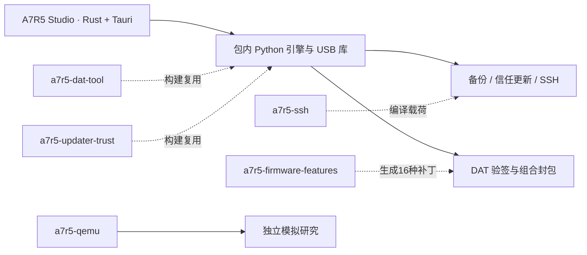

# A7R5 Studio 与固件研究工具

面向 **Sony A7R V / ILCE-7RM5、指定官方 4.00 固件前像、macOS Apple Silicon** 的客户端和脚本工具工程。

主要能力：备份机内更新器分区、修改研究签名信任环境、按需启动 SSH、从官方 DAT 构建自定义功能包，以及独立的协议、转存和 QEMU 研究。日常操作以 **A7R5 Studio** 客户端为入口，底层模块保留独立命令行和源码。

> **本项目仅限个人非商业研究使用，禁止商用。当前仅适配 macOS Apple Silicon，尚未适配 Windows、Linux 和 Intel Mac。** 用途限制适用于作者有权授权的原创内容；第三方代码继续遵循各自许可证。详见[使用范围与非商用声明](#使用范围与非商用声明)和[平台支持与其他系统适配](#平台支持与其他系统适配)。

> 当前客户端为本地测试版，最低构建目标为 macOS 14，实际验证环境为 macOS 27.0.1 / Apple Silicon。客户端运行不依赖 QEMU、Homebrew、Node 或开发虚拟环境。容器验签、离线回归和模拟结果不能证明相机升级接纳、功能效果或断电恢复；当前客户端未完成实机验收。

2026-10-24 最新本地客户端批次为 `client-update-20261024-01`，输出位于 `a7r5-desktop/dist/client-update-20261024-01/`。该批次包含实时 USB 定位、失败记录处理、备份目录选择、16KiB 完整备份分块，以及强制安装的9块回读与独立32MiB资源预算。更新内容、使用方式和验证边界见[本次客户端更新说明](a7r5-desktop/docs/updates-20261024.md)；旧 `dist/final/` 是保留的历史包。

## 目录

- [使用范围与非商用声明](#使用范围与非商用声明)
- [平台支持与其他系统适配](#平台支持与其他系统适配)
- [如何选择入口](#如何选择入口)
- [工程结构](#工程结构)
- [环境构建](#环境构建)
- [构建客户端](#构建客户端)
- [客户端使用](#客户端使用)
- [各模块的作用与用法](#各模块的作用与用法)
- [测试与验证](#测试与验证)
- [参考项目与代码来源](#参考项目与代码来源)
- [发布内容与签名身份](#发布内容与签名身份)
- [常见问题](#常见问题)

## 使用范围与非商用声明

**本项目的使用范围为个人非商业研究，禁止商用。** 对于项目作者有权授权的原创代码、文档和整合实现，阅读、运行、修改及借助 AI 进行适配，均应限于个人学习与非商业研究。

禁止将上述内容用于销售客户端或自定义固件、提供收费刷机或解锁服务、集成到商业产品，以及其他商业经营活动。公开源码、提供研究签名公私钥或具备封包能力，均不表示授予这些商业用途。

本仓库同时保留了第三方代码、补丁、数据材料和许可证。**这些部分继续遵循其原有许可证；本声明不修改、撤销或额外限制上游已经授予的权利。** 使用或再分发第三方部分时，仍需保留相应版权、许可证及来源说明，具体范围见[第三方说明](THIRD_PARTY_NOTICES.md)和各模块的许可文件。

本仓库不提供 Sony 官方授权、固件原件的再分发授权或任何机型的升级保证。研究生成的自定义 DAT 与官方更新包有区别；涉及机内写入时，应先理解对应前像、备份和恢复限制，再自行决定是否操作。

## 平台支持与其他系统适配

### 当前适配范围

| 平台 | 当前状态 | 使用边界 |
|---|---|---|
| macOS / Apple Silicon（arm64） | 当前适配目标 | 客户端最低构建目标为 macOS 14；已有本机验证环境为 macOS 27.0.1，未覆盖所有系统版本或所有 Mac |
| macOS / Intel（x86_64） | 未适配、未验收 | 当前包内 Python、动态库和打包流程面向 arm64，不能直接使用现有测试包 |
| Windows | 未适配、未验收 | 缺少本工程对应的权限、USB 接管、依赖封装和安装包实现 |
| Linux | 未适配、未验收 | 缺少本工程对应的设备权限、USB 接管、依赖封装和安装包实现 |

Tauri 和部分 Python 依赖具备跨平台能力，但本工程仍包含 macOS 专用的授权、USB 状态观察、文件权限和打包逻辑。不能仅切换 Rust 编译目标就宣称支持其他系统。DAT 格式处理与补丁算法可以作为移植基础，其命令行入口也需要在目标系统上另行验证。

相机适配与电脑平台适配是两个独立问题：即使完成 Windows 或 Linux 客户端，也仍只对应已适配的 ILCE-7RM5 和指定官方 4.00 前像，不会自动支持其他相机或固件。

### 让 AI 参考本工程进行移植

如需其他系统，可以让 AI 阅读本仓库并协助修改。建议先提供目标系统、CPU 架构和所需功能，例如“Windows 11 / x86_64，需要客户端和 USB 操作，不需要 QEMU”，再要求它分析以下平台边界：

| 位置 | 移植时需要处理的内容 |
|---|---|
| [authorization.rs](a7r5-desktop/src-tauri/src/authorization.rs)、[runtime.rs](a7r5-desktop/src-tauri/src/runtime.rs)、[tasks.rs](a7r5-desktop/src-tauri/src/tasks.rs) | Terminal/`sudo` 管理员授权、固定助手隔离、Unix 文件描述符、属主与权限、提权后任务结果导出 |
| [host.py](a7r5-desktop/engine/host.py) | 基于 `ioreg` 的 USB 身份、端口及 MSC 恢复观察；需要目标系统对应实现 |
| [usb_adapter.py](a7r5-desktop/engine/system_dump/usb_adapter.py)、[session.py](a7r5-desktop/engine/system_dump/session.py) | libusb 设备接管、系统驱动交互、重枚举与会话边界 |
| [prepare.py](a7r5-desktop/scripts/prepare.py)、[build_usb.py](a7r5-desktop/scripts/build_usb.py)、[package.py](a7r5-desktop/scripts/package.py) | 目标系统的独立 Python、原生库和密码库、Mach-O 依赖改写、`codesign`、`.app` 与安装包生成 |
| [bootstrap.sh](scripts/bootstrap.sh)及各模块启动脚本 | Shell、虚拟环境目录和固定 Homebrew 工具路径；Windows 需要对应入口 |
| [platform_backend.py](a7r5-qemu/tools/platform_backend.py) | 可选 QEMU 模块的 macOS arm64 限制和强制沙箱；不使用 QEMU 的客户端移植无需包含此模块 |

建议按以下顺序推进，并要求 AI 保留可观察的验证证据：

1. 先读取源码、模块说明和来源许可证，列出平台专用接口与缺失依赖，明确只移植哪些模块。
2. 保留 DAT 格式、固定输入摘要、机型与前像门槛、单任务锁和失败记录；为目标平台实现权限、USB 及运行资源封装。
3. 保持同一次 USB 会话中的序列号、失步状态和最终 STOP 规则，保留“备份与更新分开、SSH 上传与启动合并”的行为。
4. 在不连接相机的条件下完成单元测试、固件封包回读、目标平台构建和独立应用自检，再检查应用是否依赖开发机目录。
5. 将真实 USB 接管、机内写入、卡刷和恢复列为单独验收，取得明确授权后才执行；仅在目标平台验证通过后标注支持。

不要让 AI 通过删除平台检查、放宽摘要与机型校验、关闭沙箱或忽略失败状态来“适配成功”。当前仓库没有提供已经验收的 Windows、Linux 或 Intel Mac 版本。

## 如何选择入口

| 目标 | 推荐入口 | 是否需要相机 |
|---|---|---|
| 双击操作备份、信任更新、SSH 和固件封包 | `A7R5 Studio.app` | 设备动作需要；固件封包不需要 |
| 开发时直接启动最新源码，无需生成安装包 | [启动A7R5客户端.command](启动A7R5客户端.command) | 启动与离线自检不需要；设备动作需手动发起 |
| 阅读、验签、解包、重新打包 DAT | `a7r5-dat-tool/dattool` | 不需要 |
| 应用四项功能的整合配方或单独关闭 NTSC 提示 | `a7r5-firmware-features/materials/reproduce.py` | 不需要，只修改解包工作副本 |
| 从完整分区前像重建信任候选、分类本地现场 | `a7r5-updater-trust/trust_tool.py` | 不需要 |
| 在相机内执行短命令或固定脚本 | `a7r5-exec/libjit.sh` | 默认会连接相机；`--prepare-only` 仅本机准备 |
| 使用旧 SSH 分阶段入口 | `a7r5-ssh/quick-ssh.sh` | 默认只读本地状态；显式执行才访问相机 |
| 研究一次性转存或受限 root 执行流程 | `a7r5-implementation-kit/kit.py` | 准备不需要；执行、取回和恢复按模块清单进行 |
| 研究 libJit 加载、分块响应和中断恢复 | `a7r5-libjit/` | 依所选入口；源码测试可以不接设备 |
| 模拟原厂菜单、研究输入和创意外观 | `a7r5-qemu/` | 不需要；必须补齐固定客体材料 |

本文命令默认在**仓库根目录**执行。`/path/to/...`、`CAMERA_IP`、批准短语和随机会话目录均为占位符。帮助命令、源码测试和本地构建不代表已经批准任何设备操作。

## 工程结构

```text
.
├── a7r5-desktop/               Rust + Tauri 客户端、Python 引擎及独立应用构建
├── a7r5-dat-tool/              DAT 解析、验签、组件替换、签名封包
├── a7r5-firmware-features/     四项功能说明、整合配方和源码材料
├── a7r5-updater-trust/         更新器信任算法、本地候选及专用部署器
├── a7r5-exec/                  libJit / kit 两种短任务执行入口
├── a7r5-libjit/                一次性加载器、传输协议和恢复研究
├── a7r5-ssh/                   SSH 载荷、按需服务及旧实现源码
├── a7r5-implementation-kit/    固件转存、root 任务和主机校验流程
├── a7r5-qemu/                  可选原厂菜单与 CP / 创意外观模拟研究
├── a7r5-firmware-images/       本地固件原件与分区镜像，不进入 Git
├── scripts/                   环境准备、本地输入检查和发布检查
├── tests/                     发布边界回归测试
├── docs/                      构建输入、清理、迁移和验证记录
├── requirements-dev.txt       根目录 Python 开发依赖
└── THIRD_PARTY_NOTICES.md      代码来源与许可说明
```

客户端构建从 DAT、信任、功能和 SSH 模块中准备独立运行材料。最终应用使用包内引擎和预编译载荷，不在用户电脑上调用 QEMU 或交叉编译器。



两个原中文模块已改名为 `a7r5-firmware-features` 和 `a7r5-firmware-images`。仅统一了顶层模块目录，内部中文说明、镜像分类和历史回执保留。旧外部绝对路径不再有效，详见 [目录迁移说明](docs/module-renaming.md)。

## 环境构建

### 1. 区分使用客户端与开发源码

- **使用完整 `.app`**：不需要安装 Python、Rust、LLVM、Node、QEMU 或 Homebrew；应用携带运行依赖。设备操作时需要 Mac 管理员授权。
- **仅运行 DAT 和源码基础测试**：需要 Python 3.14、uv 和 Git。项目整体按 Python 3.14 准备；不要因某个子模块声明支持更低版本就改动客户端构建解释器。
- **从源码构建客户端**：另外需要 Rust、Xcode Command Line Tools、LLVM/lld、固定固件材料和 SFTP 依赖。
- **开发 QEMU 模块**：另外准备 Qt、QEMU 构建依赖和固定客体文件；它不是构建客户端的前置条件。

当前仓库不携带完整固件、分区原件、SDK 二进制、开发 `.venv` 或最终安装包。因此，克隆源码后可以先运行基础测试，不能直接把仓库当作完整的独立应用包。

### 2. 安装系统开发工具

在 Apple Silicon Mac 上准备 Xcode Command Line Tools；尚未安装时执行：

```sh
xcode-select --install
```

已有 Homebrew 时，按开发范围安装依赖：

```sh
# Python 环境管理；其余依赖仅在需要构建或使用相应模块时安装。
brew install uv

# 客户端载荷构建与旧 USB 脚本依赖。
brew install llvm lld libusb

# 部分原厂镜像检查、转存取回研究使用 debugfs。
brew install e2fsprogs
```

Homebrew 安装方法见 [Homebrew 官网](https://brew.sh/)。Rust 使用 [rustup 官方安装说明](https://rustup.rs/)，Tauri 的系统要求见 [官方前置条件](https://v2.tauri.app/start/prerequisites/)。本项目直接使用 Cargo 和静态 `web/`，不需要安装 Node、npm 或 Tauri CLI。

现有交叉编译脚本使用 `/opt/homebrew/opt/llvm/bin/clang` 和 `/opt/homebrew/opt/lld/bin/ld.lld`；旧 USB 脚本还使用 `/opt/homebrew/opt/libusb/lib/libusb-1.0.dylib`。不同安装位置需要先适配脚本，不能跳过依赖摘要检查。

上述安装命令会下载软件或修改开发环境，本文编写和验证过程没有执行这些系统安装动作。

### 3. 准备 Python 环境

[uv 安装说明](https://docs.astral.sh/uv/getting-started/installation/)与 [Python 管理说明](https://docs.astral.sh/uv/guides/install-python/)可作为参考。在仓库根目录执行：

```sh
uv python install 3.14
A7R5_BUILD_PYTHON="$(uv python find 3.14)" sh scripts/bootstrap.sh
chmod 600 a7r5-dat-tool/keys/research-signing-private.pem
```

`bootstrap.sh` 创建或复用以下两个虚拟环境，并使用锁定依赖安装：

| 环境 | 用途 |
|---|---|
| `.venv/` | 发布检查、源码测试、信任与载荷构建 |
| `a7r5-dat-tool/.venv/` | DAT 工具，以及客户端构建时复制的 NumPy / 密码库 |

脚本不启动客户端、不枚举 USB、不连接相机。初次安装依赖需要联网；本机缓存完整时可设置 `UV_OFFLINE=1`。Git 不保存私钥的 0600 权限，因此克隆后需要上面的 `chmod`；DAT 工具的依赖安装入口也会处理已有私钥的权限。

不要用 `sudo pip` 或修改系统 Python。后续命令显式使用 `.venv/bin/python -B`；`-B` 避免在源码或已封装资源中生成字节码缓存。

### 4. 先验证不依赖固件的功能

```sh
.venv/bin/python -B -m unittest discover -s tests -v
.venv/bin/python -B -m pytest -p no:cacheprovider a7r5-dat-tool/tests -q
.venv/bin/python -B a7r5-firmware-features/materials/selftest.py
.venv/bin/python -B scripts/release_check.py
```

前三组测试使用临时文件和临时签名身份，不读取相机，也不要求完整固件。发布检查允许当前已获公开授权的研究私钥，仍会拦截其他私钥、错误路径和禁止发布的产物。

## 构建客户端

### 1. 准备固定输入

| 材料 | 项目中的位置 | 来源与要求 |
|---|---|---|
| 指定官方 4.00 DAT | `a7r5-firmware-images/官方升级包/BODYDATA.DAT` | 754525608 字节；不接受其他版本或同名替换文件 |
| 完整一号明文分区前像 | `a7r5-firmware-images/标准固件_19项/明文分区_17项/cnflasha1.img` | 25100288 字节；必须来自已核验材料 |
| 目标 libc SDK | `a7r5-exec/sdk/libc-2.25.so` | 原厂 AArch64 库，按固定摘要核对 |
| SFTP 服务程序 | `a7r5-ssh/ssh-service/original-view/vendor/sftp-server.arm64` | 从固定 Debian 包提取，按包和二进制摘要核对 |
| 研究签名身份 | `a7r5-dat-tool/keys/` | 当前公私钥随源码提供，权限与配对必须通过 |

官方 DAT 的 SHA-256：

```text
51e1176a255a9a4b4782dfbcfa6c5f332b71173bdfe9ed2bcf4fca6bcbc6c2e2
```

一号明文分区原像的 SHA-256：

```text
acf32d30dd883ed349738e66fb081e85e0d6a3c746f5e3ca169031e8d69ed731
```

其他固定摘要见 [本地输入清单](scripts/local-inputs.json)。仓库不自动下载 Sony 固件或从相机采集这些材料；无法提供精确输入时应停止构建。

SFTP 的固定包地址与摘要见 [依赖来源记录](a7r5-ssh/ssh-service/original-view/vendor/sftp-provenance.json)。取得对应 `openssh-sftp-server_7.4p1-10+deb9u7_arm64.deb` 后执行：

```sh
.venv/bin/python -B scripts/prepare_sftp.py /path/to/openssh-sftp-server_7.4p1-10+deb9u7_arm64.deb
.venv/bin/python -B scripts/check_local_inputs.py --module desktop
```

提取器不联网、不执行 Debian 包内程序、不覆盖已有输出。来源记录没有宣称验证 Debian 发行签名或从源码重建该二进制。更多输入细节见 [构建输入说明](docs/build-inputs.md)。

### 2. 生成运行材料并构建

确认每一步成功后再执行下一步。首次构建会下载 libusb 源码、Rust 依赖和部分版权资料；整个流程不需要相机。固件封包建议至少预留 8 GiB 空闲空间，Rust 构建缓存还会额外占用空间。

```sh
# 固定版本 libusb，构建最低系统目标为 macOS 14 的动态库。
.venv/bin/python -B a7r5-desktop/scripts/build_usb.py

# 准备独立 Python、USB 依赖、信任载荷、SSH 载荷及16种功能组合。
.venv/bin/python -B a7r5-desktop/scripts/prepare.py all

# 先取得锁定 Rust 依赖的源码，版权收集器需要本机 Cargo registry。
cargo fetch --manifest-path a7r5-desktop/src-tauri/Cargo.toml --locked
.venv/bin/python -B a7r5-desktop/scripts/notices.py

# 版权文件写入后重新封存摘要，再构建主程序。
.venv/bin/python -B a7r5-desktop/scripts/prepare.py seal
MACOSX_DEPLOYMENT_TARGET=14.0 cargo build --manifest-path a7r5-desktop/src-tauri/Cargo.toml --release --locked

# 输出必须是新的交付目录；不覆盖已有 final 安装包。
.venv/bin/python -B a7r5-desktop/scripts/package.py a7r5-desktop/dist/local-build
```

输出包含：

```text
a7r5-desktop/dist/local-build/
├── A7R5 Studio.app
├── A7R5-Studio-0.1.0-mac-arm64-test.zip
└── package.json
```

`prepared/engine/` 是生成的运行材料，`src-tauri/target/` 是 Cargo 构建产物，`dist/` 是安装包，三者均不进入 Git。`web/` 是直接嵌入的 HTML/CSS/JavaScript，不运行前端依赖安装。

### 3. 检查构建结果

```sh
codesign --verify --deep --strict 'a7r5-desktop/dist/local-build/A7R5 Studio.app'
'a7r5-desktop/dist/local-build/A7R5 Studio.app/Contents/MacOS/a7r5-desktop' --selfcheck
```

自检检查包内材料、签名身份配对和运行依赖，不枚举相机。当前打包脚本使用临时签名，没有 Developer ID 签名和公证；其他 Mac 的系统放行结果不属于已验证范围。不要通过关闭系统安全机制解决应用无法打开的问题。

修改引擎、依赖或版权文件后，需要重新准备、封存和构建，不能继续使用旧资源摘要。不要在已签名 `.app` 内随意增删文件，也不要用 `codesign --deep --force` 改写内层签名后沿用旧摘要。

## 客户端使用

### 1. 启动与准备

取得完整应用后，先正常退出旧客户端，再解压 ZIP，双击 `A7R5 Studio.app`。最新本地包保存在 `a7r5-desktop/dist/client-update-20261024-01/`，旧包与现有记录保留；包不包含在 Git 源码中，也没有在本工程创建公开下载地址。新包的批次、源码摘要、ZIP 摘要和离线自检见同目录 `package.json` 与 `offline-verification.json`。

应用启动时不枚举相机。只有点击设备动作、阅读准备提示并继续后，才申请管理员权限、定位唯一相机并校验型号、接口、版本、端口和相关内容摘要。未知状态会停止。

每次 USB 操作前：

1. 保持相机稳定供电，用可靠数据线连接 Mac。
2. 在相机选择「海量存储器 / MSC」。
3. 如果没有模式选项，仅在任务尚未开始、或已核实完成时重新拔插。
4. 继续操作后，在自动打开的**终端**中按 `sudo` 提示输入这台 Mac 的管理员密码；输入时不显示字符。

Mac 管理员密码与相机 SSH 密码是两套不同凭据。管理员密码由终端内的系统 `sudo` 接收，客户端不接收或保存；固件封包不申请管理员授权。执行中、协议失败或结果未知时，保持供电和连接，不重复点击、不拔插、不关机。

### 2. 备份更新器

在「相机维护」可先选择**备份保存目录**，再点击 **备份当前环境**，按准备与授权提示执行。它读取完整更新器分区并核对摘要，不同时修改信任环境。未选目录时保存到任务目录；选择后会在目标目录中新建独立备份文件夹，原任务记录继续保留。任务卡片提供“打开备份目录”。

普通信任更新需要选择**备份任务外层的 `result.json`**，或另存备份文件夹中的 `result.json`；不要选择 `device/result.json` 或其他任务的结果。备份与更新是两个独立动作，各自使用一次 USB 会话。完整本机备份核验和持久化完成后，才允许清理本次机内临时副本；不清理历史备份。失败时保留现场与已完成分块进度，不自动续传或重试。

### 3. 更新研究签名信任环境

在「相机维护」选择已经完成的备份记录，点击 **更新信任环境**。后台核对本次备份和相机当前完整前像，再执行固定扇区计划、同步及完整回读。

另有独立的 **强制安装（跳过原厂前像限制）**：不要求成功原厂备份或原厂前像匹配，但仍核对设备、版本、固定258个计划扇区及写后结果。新版强制模式保留机内整分区摘要与重开校验，电脑只回读全部计划扇区的132096字节（9块），最低可用内存为32MiB；普通安装和完整备份保持原预算。它可能覆盖已有修改，未知内容的兼容性没有保证，也没有自动回滚。详情见[更新说明](a7r5-desktop/docs/updates-20261024.md)。

这是相机内更新器的信任环境修改，用于配对研究签名身份；不是把 DAT 更新包上传到相机，也不等于已经完成卡刷。写入非原子，258 个扇区的日志与完整回读不能保证任意断电或硬件故障下恢复。

设备任务完成后，客户端观察本次MSC恢复；也可按需记录屏幕确认。历史失败和待恢复记录保留，不再阻止新任务；每次新任务重新识别当前唯一A7R5及其端口，不自动重试旧任务。

### 4. 开启和停止 SSH

进入「SSH 服务」，输入两次本次相机密码，点击 **上传并开启 SSH**。客户端将三个程序的上传、校验和服务启动合并到同一次 USB 会话，完成后统一退出。

- 密码支持 8–128 个非控制字符，最多 512 个 UTF-8 字节，可含字母、数字和符号。
- 界面不保存明文；任务材料仍保留机内认证所需的口令哈希和配置载荷，不应公开任务目录。
- SSH 用户为 `root`，端口为 `2222`。应用不自动设置 Wi-Fi、不探测 IP、不自动完成 SSH 网络登录。
- 根据相机实际网络环境确定 `CAMERA_IP`，先核对任务中的 `device/session/host-public-key`，再连接。

```sh
# 将路径和 IP 替换为本次任务的实际值；不执行主机密钥检查绕过。
ssh-keygen -lf '/path/to/task/device/session/host-public-key'
ssh -p 2222 root@CAMERA_IP
```

启动成功表示机内身份、公钥、监听回执及心跳等门槛通过，不代表电脑已经能通过网络登录。要结束服务，退出自己的 SSH 会话，再在客户端点击 **停止本次 SSH**；仍需 MSC 和管理员授权。客户端从当前连接确定端口，只停止同一电脑记录、会话号及主机公钥匹配的实例，不要求沿用启动时的端口。

### 5. 生成自定义固件

进入「固件工坊」：

1. 选择精确匹配的官方 4.00 `BODYDATA.DAT`。
2. 选择不存在的新输出文件路径。
3. 独立勾选四项功能，可形成 16 种组合。
4. 核对输出容器版本，默认 `4.06`，点击 **封装更新包**。

| 功能 | 实现内容 |
|---|---|
| FL2 / FL3 | 启用对应创意外观选择与参数 |
| 六款自定义滤镜 | Classic Neg.、Classic Chrome、Nostalgic Neg.、Astia、GR Positive Film、GR Negative Film |
| 关闭 NTSC 提示 | 跳过已定位的提示，不改变视频制式 |
| 电子快门声音 | 加入已适配条件下的声音包装逻辑，不承诺所有拍摄模式均生效 |

后台从官方原包构建，独立验签并回读解密帧，原文件不修改。生成结果旁有 JSON 回执和更新说明 HTML。关闭某项恢复其对应入口，部分组合仍共享必要的数据布局；全不选仍会使用研究签名。

`4.06` 只是输出容器版本，不表示获得官方同号版本的功能，也不保证机身接纳。首次操作应先阅读生成回执与说明，不把“封包成功”视为可直接刷入任意 A7R5。

### 6. 存储卡更新与状态提示

先完成与当前研究公钥配对的更新器信任配置，再依照本次生成的 HTML 指引核对机型、前像、供电和存储卡：

1. 备份存储卡资料，使用充足电量，按官方要求取下竖拍手柄。
2. 将输出文件命名为 `BODYDATA.DAT`，放在存储卡**根目录**，不要放进 `DCIM`，不要有“副本”或额外后缀。
3. 安全弹出卡，关闭相机后插入 **SLOT1**。
4. 开机进入 `MENU → 设置 → 设置选项 → 版本 → 软件更新`，部分布局先选择“机身”，核对屏幕显示后操作。

当前[随包卡刷指引](a7r5-desktop/engine/card-guide.html)将黑屏、存取灯按 1→3→5 次分组闪烁、约 6 分钟后自动重启列为官方 4.00 流程的参考现象；5 慢＋6 快或 7 慢＋7 快反复出现列为异常。参考来源为 [Sony 官方 4.00 升级说明](https://service.sony.com.cn/download/firm/00003037.html)。这些描述不能证明自定义包进度正常；不能仅凭计时或黑屏决定断电。

应用不会自动写存储卡或启动机身升级。异常时保留 DAT、回执和灯号/画面记录，不盲目拔电或重复刷写。完成后核对机身版本，并逐项验证所选功能。

### 7. 任务记录和恢复

客户端任务位于：

```text
~/Library/Application Support/local.a7r5.studio/tasks/
```

「任务记录」用于查看回执、备份、失败现场和可选恢复检查。历史待恢复记录不再作为新任务门禁，无需删锁或改写旧结果。活动SSH实例仍须通过停止任务核对身份与结束回执；本地记录不证明当前网络登录或机内服务状态。

## 各模块的作用与用法

### a7r5-desktop：桌面客户端

- `src-tauri/src/`：Tauri 命令、口令哈希、任务状态、系统授权与资源完整性。
- `web/`：中文界面和操作提示。
- `engine/`：设备事务、MSC 恢复观察、DAT 功能封包及卡刷指引。
- `sources/`：应用专用原生载荷源码。
- `scripts/`：依赖准备、载荷编译、版权收集、封装和独立验证。

构建和使用见上文；具体实现说明见 [客户端 README](a7r5-desktop/README.md)。应用中的备份、更新和 SSH 流程不能与旧脚本的一次性操作包混用。

### a7r5-dat-tool：DAT 容器工具

负责查看、验签、解包、定向替换组件、更新相关校验、加密签名封包。它没有 USB、SSH、写卡或刷机入口。

```sh
./a7r5-dat-tool/dattool --help
./a7r5-dat-tool/dattool inspect /path/to/BODYDATA.DAT
./a7r5-dat-tool/dattool verify /path/to/BODYDATA.DAT

mkdir -p .local/examples
./a7r5-dat-tool/dattool unpack /path/to/BODYDATA.DAT --output .local/examples/dat-work

# 修改工作目录中已有的组件后，写入新的 DAT；不传版本则保留输入版本。
./a7r5-dat-tool/dattool pack .local/examples/dat-work --output .local/examples/custom.DAT --version 4.06
./a7r5-dat-tool/dattool verify .local/examples/custom.DAT
```

`inspect` 检查外层 CRC、签名和首段格式头；`verify` 还验证全部解密帧与归档成员。解包生成 `manifest.json`、`archive/`、`components/` 和 `format/`；常用组件为 `components/usr/lib/appFw.so`、`components/cpapp-b.bin` 与菜单 UXC 资源。

输入、工作目录和输出有严格边界：新目录/文件不能已存在；同一分区的原始镜像与内部组件不能同时修改；`INCOMPLETE.json` 表示失败现场，不能继续封包。详见 [DAT 工具说明](a7r5-dat-tool/README.md)。

### a7r5-firmware-features：功能配方与研究材料

包含四项功能的实现说明、定长补丁、资源修改和组合所需材料。日常自由组合使用客户端；独立 `reproduce.py` 只提供 `all` 和 `ntsc-only` 两种配方入口，不是 16 组合命令行界面。

```sh
# 先用 DAT 工具从指定官方原包生成全新工作目录。
.venv/bin/python -B a7r5-firmware-features/materials/reproduce.py \
  --workspace .local/examples/dat-work \
  --feature all \
  --receipt .local/examples/features.json

# 补丁回执成功后，再按 DAT 工具流程封包到新的输出。
```

仅关闭 NTSC 提示时，在另一份从官方原包新解出的工作目录使用 `--feature ntsc-only`。两种配方都保留该实现规定的 WBI 标记变化；四份正文对应同一整合实现，不能把其中的 CP 补丁当作相互独立的文件任意覆盖。`materials/source/` 是审阅快照，其中保留旧路径，不作为新的执行入口。

实现文档：[FL2/FL3](a7r5-firmware-features/01_FL2和FL3启用实施细节.md)、[六款外观](a7r5-firmware-features/02_六款自定义滤镜实施细节.md)、[NTSC 提示](a7r5-firmware-features/03_关闭NTSC提示实施细节.md)、[快门声音](a7r5-firmware-features/04_电子快门声音启用实施细节.md)。

### a7r5-updater-trust：更新器信任环境

`src/` 提供 FAT / SquashFS 读取、库修改和扇区计划。`trust_tool.py` 只处理本地普通文件：

```sh
.venv/bin/python -B a7r5-updater-trust/trust_tool.py --help
.venv/bin/python -B a7r5-updater-trust/trust_tool.py inspect \
  --image a7r5-firmware-images/标准固件_19项/明文分区_17项/cnflasha1.img

mkdir -p .local/examples
.venv/bin/python -B a7r5-updater-trust/trust_tool.py build \
  --source a7r5-firmware-images/标准固件_19项/明文分区_17项/cnflasha1.img \
  --public-key a7r5-updater-trust/public-key.pem \
  --output .local/examples/trust-candidate
```

输出为候选镜像、前后扇区、写入计划与回执；它不写相机。`classify` 根据 `--source`、`--candidate`、`--observed` 分类本地现场，不能代替恢复写入。

`deploy/deploy.py` 是独立设备部署器，具有 `prepare`、`check`、`authorize`、`terminal`、`execute`、`status` 和 `confirm-screen`。它使用精确 profile，历史端口模板不能直接代表新用户相机状态。需要脚本部署时先阅读 [专用部署清单](a7r5-updater-trust/deploy/运行与实机确认清单.md)；普通客户端用户优先使用「相机维护」，不要将写入任务交给通用短命令执行器。

### a7r5-exec：短命令与脚本执行

提供 libJit 和 kit 两条路径。`libjit.sh` 默认准备后直接执行，会接管 USB；`kit-root.sh` 仅准备，保留独立批准和恢复流程。

```sh
./a7r5-exec/libjit.sh --help

# 仅本机准备，不查询设备、不提权、不执行相机任务。
./a7r5-exec/libjit.sh --command '/bin/cat /version.txt' --prepare-only

# 仅本机检查既有材料封印。
./a7r5-exec/a7r5-exec.sh check-tool
```

只有已完成环境核对、明确允许接设备时，才去掉 `--prepare-only`。脚本参数为 `--script /path/to/task.sh --timeout 15`，当前时限 1–60 秒、输出上限 32 KiB；它是相机内 root 执行，不是安全沙箱，也不是交互终端。

该模块依赖本地 SDK、`TOOL.json` 和冻结依赖。新克隆缺少这些材料时，`check-tool` / 准备失败是预期结果，不能直接复制旧批准。详见 [执行工具说明](a7r5-exec/README.md)。

### a7r5-libjit：加载协议与恢复研究

研究精确 `/tmp/jiritsu/libJit.so` 写入触发加载的路径，并提供无 libc 依赖的载荷、32 KiB 传输边界处理、终态核对和中断恢复协议。

```sh
.venv/bin/python -B a7r5-libjit/build.py --help
.venv/bin/python -B scripts/check_local_inputs.py --module libjit
.venv/bin/python -B a7r5-libjit/run_offline_tests.py
```

构建入口支持 `--output /new/package`，可指定候选和验证证据；生成包内的 `runner.py` 提供 `check / approve / execute / confirm-screen`。它绑定生成包位置，不能把源码目录的 `runner.py` 当作已有实例执行。

固定加载库夹具、部分历史配置与恢复证据留在本地忽略的 `packages/` 中；新克隆未携带，不能直接运行全部历史恢复测试或重新生成旧包。先核对 [模块说明](a7r5-libjit/README.md)，不要删除旧尝试锁重跑。

### a7r5-ssh：按需 SSH 服务与旧实现

保留服务载荷、账户隔离、RAM 主机密钥、SFTP 和阶段操作器。客户端支持界面输入混合字符密码；旧快捷脚本仍使用本地 `ssh-service/fixed-password-input`，不能把二者的密码处理与 USB 会话数量混为一谈。

```sh
# 以下只读本地状态或显示计划，不连接相机、不探测网络。
./a7r5-ssh/quick-ssh.sh status
./a7r5-ssh/quick-ssh.sh start

# 只准备新会话包；依赖本地口令文件、SDK 和构建材料。
./a7r5-ssh/quick-ssh.sh prepare
```

实际旧脚本启动为 `start --execute --ip CAMERA_IP`，仍要求终端批准、sudo 和阶段屏幕确认。该入口的上传与启动分成两次 USB 阶段；客户端已合并为一次。`--ip` 只用于生成登录命令，不配置相机网络。存在活动或待恢复记录会拒绝新启动，不自动清空。

详见 [SSH 模块](a7r5-ssh/README.md)和[快捷脚本说明](a7r5-ssh/快捷SSH使用说明.md)。旧会话包、账户材料和活动记录不入库，源码克隆不是已有 SSH 会话的操作凭据。

### a7r5-implementation-kit：转存与受限 root 流程

统一入口 `kit.py` 提供：

| 子命令 | 用途 |
|---|---|
| `prepare-dump --profile standard` | 准备 17 个明文分区＋2 个启动区的转存，默认 19 项 |
| `prepare-dump --profile extended` | 显式准备 37 项双视图转存 |
| `prepare-root` | 封存一次固定脚本任务 |
| `prepare-collect` | 绑定已完成转存会话的按文件取回 |
| `check / approve / execute` | 检查材料、批准特定操作、执行 |
| `confirm-recovery` | 观察主机恢复并记录人工屏幕确认 |
| `classify-images` | 核对本地原件，生成分类链接和索引 |

```sh
.venv/bin/python -B a7r5-implementation-kit/kit.py --help
.venv/bin/python -B a7r5-implementation-kit/tests/run_offline.py
```

准备类命令需指定新 `--operation` 目录，具体参数见子命令帮助。实机转存与取回需要本人的存储卡身份、精确配置和本次批准；公开源码不带这些资料。已有原件无需重新转存，不直接执行 `engine/mac/` 中封存的旧格式化入口。详见 [实施说明](a7r5-implementation-kit/README.md)。

### a7r5-firmware-images：仅本地原件目录

该目录不进入 Git，不是一个待安装的程序。克隆后需自行建立所需分类位置；现有本地材料包括：

- `官方升级包/`：指定官方 `BODYDATA.DAT`。
- `标准固件_19项/明文分区_17项/` 和 `启动区_2项/`：标准分析视图。
- `额外物理视图_18项/物理分区_17项/` 和 `整闪存_1项/`：额外物理视图。
- 分类清单、摘要和历史采集回执。

37 个分区/整闪存视图约 5.69 GB，官方 DAT 另计。明文与物理视图含义不同，不能只凭长度相同就当作重复文件删除。构建只读取原件，修改应在新工作副本上进行。输入位置与摘要见 [构建输入说明](docs/build-inputs.md)。

### a7r5-qemu：独立可选模拟研究

用于原厂菜单导航、输入、CP 和创意外观参考研究；不参与客户端 USB 操作或 DAT 封包。当前没有实现取景、实际拍照、录像、完整 CP / 电源管理，也不证明固件可安全回刷。

```sh
# 只读检查，不启动模拟器。
.venv/bin/python -B scripts/check_local_inputs.py --module qemu

# 可选开发环境。
uv venv --python 3.14 a7r5-qemu/.venv
uv pip install --python a7r5-qemu/.venv/bin/python \
  -r a7r5-qemu/requirements.txt -r a7r5-qemu/requirements-desktop.txt
```

还需要固定 QEMU 源码包、内核、初始化归档、DTB、SDK 库。当前本地清单中的 initrd 和 DTB 已缺失，输入不全时会停止；仓库不提供自动补齐方案。补齐并通过清单校验后，才可以在模块目录运行 `tools/build-native.py`、`tools/build-guest.py` 或 `client/main.py`。

Qt 源码入口为 `a7r5-qemu/client/main.py`；网页与终端入口见 [模块说明](a7r5-qemu/README.md)。旧 `.app` 路径和旧验收数字属于历史记录，不能直接作为当前源码副本可启动的证明。不要绕过沙箱和输入摘要校验。

## 测试与验证

基础测试见环境构建章节。以下模块回归需要对应本地 SDK、准备材料或固定夹具，不适合在空白克隆中直接全量执行：

```sh
.venv/bin/python -B a7r5-exec/run_offline_tests.py
.venv/bin/python -B a7r5-libjit/run_offline_tests.py
.venv/bin/python -B a7r5-implementation-kit/tests/run_offline.py
.venv/bin/python -B -m pytest -p no:cacheprovider a7r5-desktop/tests -q
```

客户端测试依赖 `prepared/engine/` 的模板、扇区计划和 PMCA 源码，普通文件测试还需要精确分区前像。正常完成客户端材料准备后再运行。

2026-10-24 最新客户端代码已通过250项离线回归；界面13项成功证据与相同网页源码对应。本次打包另验证发布编译、签名、ZIP 解压和脱离工程的受限离线自检，具体结果以[本次更新说明](a7r5-desktop/docs/updates-20261024.md)及包内回执为准。这些证据不代表新资源预算下的相机安装或USB超时已实机验收。

2026-10-23 已有本机回归、独立源码副本重建与应用自检记录，见 [发布整理验证](docs/verification.md)。本次英文目录迁移又通过发布边界、功能配方、客户端引擎和 QEMU 路径测试，见 [迁移验证](docs/module-renaming.md)。这些结果与真实相机操作分开记录。

修改 Rust 或完整资源封印后，可按客户端说明运行 Cargo 测试与 `scripts/verify_independent.py`；独立验证会生成较大的临时 DAT、执行 16 组合并在沙箱中检查隔离，不连接相机。不要在仅改文档时反复重建全部缓存。

## 参考项目与代码来源

这里区分直接保留的代码/材料、技术路线参考与常规依赖。下表依据仓库内的来源清单、源码注释和许可证编写；上游当前主分支不等于本工程使用的固定版本，不能直接套用其他机型的补丁。

### 研究项目与材料

| 项目 | 本工程的引用或参考范围 | 版本与本地依据 |
|---|---|---|
| [Hearts-Ace/sony-a7r5-custom-firmware](https://github.com/Hearts-Ace/sony-a7r5-custom-firmware) | DAT 容器、加密封包、FAT / ext2 定向修改等既有研究脚本的来源 | [来源说明](a7r5-dat-tool/licenses/NOTICE.md)、[冻结文件摘要](a7r5-dat-tool/SOURCE_FILES.json)、[原许可证副本](a7r5-dat-tool/licenses/reference-LICENSE)；没有为该来源独立补造提交号 |
| [chocotan/a7c2-re](https://github.com/chocotan/a7c2-re) | libJit 入口、QEMU 实验和 SSH 可行性技术路线；按 A7R5 前像单独适配 | libJit / QEMU 参考提交 `5ec277d8aa50704c1211a7c114730391fcd25a40`；SSH 参考提交 `433737ae5a8a241ae86eb307a12bb6a2c33600c7`，见 [SSH 来源](a7r5-ssh/reference/upstream.json) |
| [QAQLeonard/a7c2-fl23-research](https://github.com/QAQLeonard/a7c2-fl23-research) | 六款默认自定义外观材料及相关研究资料 | `v3.0.1`、提交 `c8328ad5ee485efec4f6aa51314f6062d79533e1`；见 [材料说明](a7r5-firmware-features/materials/NOTICE.txt)与 `upstream-default-six/` |
| [ma1co/Sony-PMCA-RE](https://github.com/ma1co/Sony-PMCA-RE) | 定向冻结的 `pmca.usb` 认证、协议常量和辅助代码 | 位于多个模块的依赖快照，客户端构建从信任模块复制；文件摘要见 [依赖来源清单](a7r5-updater-trust/deploy/source-provenance.json)，版权由 `scripts/notices.py` 收集 |
| [Jannchie/llr](https://github.com/Jannchie/llr/blob/main/sony_repro/PIPELINE.md) | Sony 颜色管线及 CC1 耦合的技术参考 | [look_chroma.py](a7r5-qemu/tools/look_chroma.py) 注释和独立公式实现；不是引入外部拟合染色资产，也不是相机像素效果验收 |
| [DavidBuchanan314/Sony-ILCE-7M4-Linux](https://github.com/DavidBuchanan314/Sony-ILCE-7M4-Linux/tree/fa5c6f6aba58f675691e5adf291b155b76e6e93e) 与 [Linux](https://github.com/torvalds/linux) | CP / PCIe / DMA / 时钟及 Linux ABI 的文档、寄存器和行为参考 | 依据 [CP 研究规格](a7r5-qemu/specs/003-virtual-media-and-imaging/)，不表示本客户端编译或分发完整上游内核 |

DAT 的冻结来源还记录了 `vendor/fwtool/sony/constants.py`。相关公开格式工具为 [ma1co/fwtool.py](https://github.com/ma1co/fwtool.py)；本仓库没有为该间接常量来源单独锁定提交，不将其描述为整体移植或独立第二套验收解析器。

### 框架与运行依赖

| 项目 | 用途 | 当前锁定或来源 |
|---|---|---|
| [Tauri](https://github.com/tauri-apps/tauri) 与 [插件工作区](https://github.com/tauri-apps/plugins-workspace) | Mac 桌面外壳、原生命令与文件选择 | `tauri 2.12.4`、`tauri-build 2.7.3`、`tauri-plugin-dialog 2.8.3`，完整锁定见 `Cargo.lock` |
| [RustCrypto sha-crypt](https://github.com/RustCrypto/password-hashes/tree/master/sha-crypt) | Rust 内部计算相机 SSH 密码哈希 | `0.5.0`；不通过命令行传明文密码 |
| [PyUSB](https://github.com/pyusb/pyusb) / [libusb](https://github.com/libusb/libusb) | USB 传输接口和原生动态库 | PyUSB `1.3.1`；客户端固定构建 libusb `1.0.30`，源码摘要见 `build_usb.py` |
| NumPy、PyCryptodome、cryptography、cffi | 固件数据处理、加解密和独立回读验证 | 版本见 [DAT 锁定依赖](a7r5-dat-tool/requirements-lock.txt) |
| pyelftools、Capstone、Unicorn | ELF / 机器指令与离线执行研究 | 版本见 [根开发依赖](requirements-dev.txt) |
| OpenSSH / Debian openssh-sftp-server | 目标相机上的固定 SFTP 子系统依赖 | 包和文件摘要见 [SFTP 来源](a7r5-ssh/ssh-service/original-view/vendor/sftp-provenance.json)，版权副本同目录保留 |
| QEMU、DTC、PySide6 / Qt、Pillow、Nuitka | 可选模拟后端、菜单界面、帧处理和独立包 | 固定源码清单、补丁、许可证位于 `a7r5-qemu/source/qemu/`，Python 版本见其 requirements 文件 |

更多许可证与出处见 [第三方说明](THIRD_PARTY_NOTICES.md)。项目原创内容按[个人非商业研究用途声明](#使用范围与非商用声明)提供，不应将公开托管理解为不受限制的开源授权；上游代码保留其原有许可证。

## 发布内容与签名身份

**进入源码发布：** 自有源码、测试、配方、说明、必要的依赖源码快照，以及持有人明确授权公开的研究公私钥。

**仅留本地：** `a7r5-firmware-images/`、其他 SSH 私钥与口令文件、真实设备操作包、活动记录和锁、`.venv/`、构建缓存、生成材料及最终 `.app` / ZIP。不要把任务日志或完整镜像当作示例提交。

研究私钥不是 Sony 官方私钥。这一身份已经按公开身份处理，任何取得源码的人都可以使用它签名，不能据此认证固件作者；不要将其用于其他秘密或认证用途。更换身份需要同时适配公钥与机内信任规则，详见 [密钥说明](a7r5-dat-tool/keys/README.md)。

```sh
.venv/bin/python -B scripts/release_check.py --report .local/release-check.json
# 目标目录必须不存在且位于工程外。
.venv/bin/python -B scripts/release_check.py --export ../a7r5-source-release
```

发布检查按精确路径与固定摘要仅允许当前研究私钥，其他私钥仍会被拦截；已有 Git 仓库中被错误跟踪的忽略文件也会参与检查。工具不扫描历史、不创建提交、不设置远端、不上传。不要用 `git add -f` 绕过规则。

最终安装包仍为本地临时签名测试包，源码公开不代表这些安装包已经获准对外发布。清理和保留策略见 [清理记录](docs/cleanup.md)。

## 常见问题

**源码克隆后为什么不能直接构建客户端？**

缺少未分发的官方 DAT、分区前像、libc SDK 或 SFTP 程序时会停止。先运行输入检查，依照清单准备精确材料；不要用同名文件替代。

**为什么运行 `libjit.sh` 会要求管理员密码？**

它默认实际执行 USB 任务。只准备材料请显式加 `--prepare-only`；图形客户端的管理员密码由 macOS 窗口接收。

**为什么还要在相机上选择 MSC？**

USB 服务完成后可能恢复到连接模式选择状态。每个独立设备动作仍需 MSC，客户端只将 SSH 上传和启动合并，备份与信任更新保持分开。

**为什么固件已经验签通过，还不能保证卡刷？**

验签和解密回读检查容器及输出一致性；机身版本准入、完整启动、功能效果和故障恢复需要独立实机验证。

**换 USB 端口后旧脚本不能运行怎么办？**

部分旧脚本固定绑定开发时的端口、媒体和版本，不能通过放宽检查或编辑旧批准解决。客户端会从当前唯一相机重新建立绑定，但未知机型、版本和分区仍拒绝。

**换 USB 端口后客户端可以使用吗？**

可以。备份、更新信任环境、开启/停止SSH及独立MSC检查都会在每次操作时重新识别当前唯一A7R5和当前端口。历史待恢复记录及屏幕确认不再阻止新任务；普通更新仍核对已完成原厂备份的内容与摘要，显式强制模式采用独立准入。执行中的会话不自动换设备。

一次正在执行的USB会话仍绑定本次设备和物理端口，执行中位置变化时停止，不自动切换设备。维护任务不因历史SSH实例记录而要求先停服，也不会自动停止SSH；需要执行SSH停止任务时，可以使用当前新端口，但必须匹配原实例的会话号与主机公钥。换端口行为目前只完成离线验证，没有连接相机验收。

**QEMU 提示输入缺失怎么办？**

当前 initrd、DTB 和部分研究工作副本未随源码分发，且现有本地默认客体文件也不完整。补齐固定摘要材料前仅阅读源码，不改清单或以其他镜像绕过。

**能让 AI 帮忙适配 Windows、Linux 或 Intel Mac 吗？**

可以将本仓库作为个人研究中的实现参考，让 AI 协助分析与修改，具体落点见[平台适配说明](#平台支持与其他系统适配)。现有源码和测试包只适配 macOS Apple Silicon，移植结果必须在目标系统独立验证。

**能直接支持其他相机固件，或增加任意功能吗？**

当前没有这些兼容性承诺。功能配方、目标库、版本内容和分区前像均是固定适配，新增目标需要独立实现和验证，不能仅修改版本号或取消校验。

**可以把客户端、修改版或生成的固件用于收费服务吗？**

不可以将本项目作者有权授权的原创内容用于商业用途，本项目仅限个人非商业研究。第三方代码的独立权利以其原许可证为准，见[用途声明](#使用范围与非商用声明)与[第三方说明](THIRD_PARTY_NOTICES.md)。
